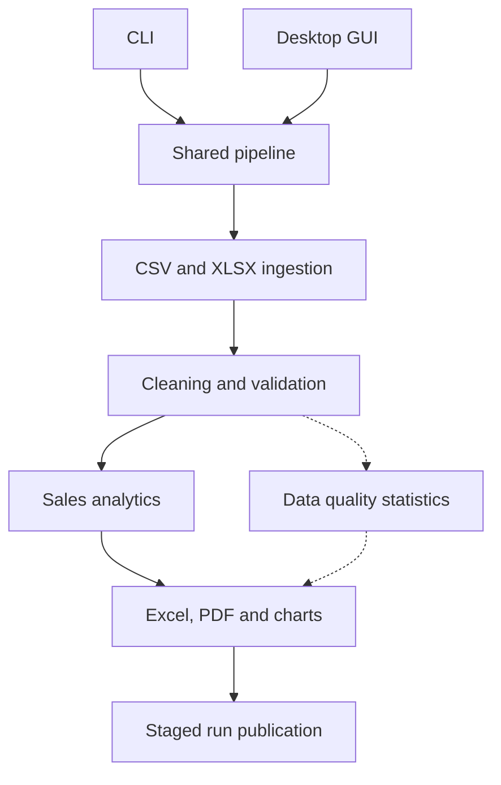

# Architecture and design decisions

`ingestion` normalizes headers and attaches source-file and row provenance.
`processing` owns all checks and calculations. `reporting` receives validated
transactions and precomputed metrics; it never rereads inputs. `pipeline` owns
the application workflow. `cli` and the optional `gui` are input/output adapters.

## Data contract

Required fields: `date`, `product`, `category`, `quantity`, `unit_price`.
Optional: `order_id`. Extra columns are ignored. Orders with multiple product
lines are represented by repeated order IDs. All input files in a run must use
the same order-ID convention.

Prices have at most two decimal places. Quantities are positive whole numbers.
Prices are converted to integer cents before multiplication and aggregation;
display values use decimal currency formats. The single currency label applies
to the whole run. Currency conversion, tax, refunds and exchange rates are not
modeled. Per-line quantities are capped at 1,000,000 and unit prices at
10,000,000,000 currency units. Aggregate integer overflow is rejected.

## Validation policy

| Policy | Behavior | Error report |
| --- | --- | --- |
| `quarantine` | Exclude invalid/duplicate rows | Raw business values, source file and row, reason and affected columns |
| `skip` | Exclude invalid/duplicate rows | Source file and row, reason and affected columns only |
| `reject_file` | Exclude every row in a file containing any invalid/duplicate row | Invalid-row diagnostics plus rejected file names in manifest |

Every error record names the source file, the `source_row` in that file, a
`reason` listing each failed check separated by `; `, and `invalid_columns`
listing the normalized column names that failed in the same order. Blank cells
are reported as `Missing <column>` so they can be told apart from malformed
values; an invalid date message includes the configured `date_format`. Text
values are trimmed before parsing, so surrounding whitespace is not an error.

Rows whose cells are all empty (trailing blank lines, empty formatted Excel rows)
are skipped before validation and logged; they are neither counted as input rows
nor treated as invalid, so they cannot trigger `reject_file`. Header cells that
are blank (trailing delimiters, empty Excel columns) are ignored. Source row
numbers always refer to the original file.

Every failed check also carries a stable code (`missing_value`, `invalid_date`,
`invalid_quantity`, `invalid_price`, `duplicate_line`) in `ValidationResult.checks`,
one row per failed check with its source file, row and column. The optional data
quality report (`processing/quality.py`) aggregates that frame by check, column,
quality dimension and source file and renders a versioned, JSON-ready mapping; it
is a pure function of the validation result and never rereads inputs or alters the
outcome. The pipeline loads inputs through `load_files_with_stats`, whose
`IngestionStats` (records read, blank rows skipped, chunks processed, chunks and
records restored from a checkpoint) are attached to the report at run level and per
file; `load_files` remains the plain wrapper. `reporting/quality_report.py` writes it as `data_quality.json` when
`quality_report` is enabled.

Schema or ingestion errors stop the whole run because the file cannot be
interpreted reliably. The message names the file and the offending headers, for
example which two headers map to one field or which headers were found when a
required column is missing. If no usable transactions remain, execution fails
before reports are written and reports the invalid-row/rejected-file counts.

Duplicates are exact normalized business-line matches, using order ID when
available, across all selected files. First occurrence wins, and the duplicate's
reason names the file and row of that first occurrence. Input order therefore
matters. Identical legitimate lines within the same order cannot be distinguished
without a transaction-line ID; the current schema does not support one. Without
order IDs, identical rows are considered duplicates even if they were separate
purchases. Use separate order IDs to preserve distinct orders. Under `reject_file`,
duplicate detection precedes file rejection, so overlap can reject a later file
even when the earlier file is also rejected for another invalid row.

Calendar months include zero-revenue gaps. Weeks end on Sunday. Month-over-month
change uses the previous calendar month, with an unavailable value for the first
month or a zero prior denominator. Partial boundary months are included and
should be interpreted accordingly. "Top products" in PNG charts ranks units sold;
the products worksheet also exposes revenue.

## Workflow engine

`workflow.py` is a small, generic engine for running named steps strictly one after
another. A `Workflow` holds an ordered list of `Step` objects; names must be unique and
non-empty, and every step is a callable receiving the shared `WorkflowContext`. The
context carries free-form `data` (seeded from the mapping passed to `run`) and the
`outputs` of every succeeded step keyed by step name, so later steps consume earlier
results without global state. Each `run` gets a fresh context and the caller's mapping
is copied, so a workflow can be executed repeatedly.

Error handling is explicit and has three outcomes per step: `succeeded`, `failed` or
`skipped`. A step that raises is retried `retries` more times. The wait before retry
`k` is `retry_delay * backoff ** (k - 1)` seconds, capped by `max_delay`; the defaults
(`retry_delay=0`, `backoff=2`) retry immediately, so backoff is opt-in and `backoff=1`
gives a constant wait. The engine never sleeps after the final failed attempt. Delays
go through the `sleep` callable given to `Workflow`, which defaults to `time.sleep` and
is replaced by a recording fake in the tests, so the schedule is tested exactly without
real waiting.

A step with a `timeout` runs each attempt in a daemon helper thread and waits at most
that many seconds. If the attempt is still running, the engine raises
`StepTimeoutError` (both a `WorkflowError` and a `TimeoutError`) for that attempt and
treats it like any other failure: it is retried according to the schedule, or recorded
as the step's failure. Python cannot kill a thread, so the abandoned attempt keeps
running until it returns; its return value or exception is discarded and never reaches
`outputs`. Timeouts are therefore meant for actions that are safe to abandon or that
honor their own deadline, and the thread-based design works from the GUI's worker
thread as well, which a `signal`-based alarm would not. Steps without a timeout run
inline in the caller's thread exactly as before.

When the attempts are exhausted and the step is required, the remaining steps are
marked skipped and `WorkflowError` is raised with the original exception chained, the
failing step name as `error.step` and the partial `WorkflowResult` as `error.result`.
The message names the step, its position, the number of attempts, the elapsed time, the
errors of earlier attempts and the skipped steps. Every `StepResult` keeps the error of
each attempt (`errors`), the last error (`error`, cleared when a later attempt succeeds),
its formatted `traceback`, the `delays` waited, `attempts`, `duration_seconds` (all
attempts including waits) and UTC `started_at`/`finished_at`. `WorkflowResult.report()`
renders the summary, one line per step and one line per failed attempt, optionally with
tracebacks; the engine logs the same report at `DEBUG` level when a run fails. A step
declared with `continue_on_error=True` records its failure and lets the run proceed;
the returned result then reports `succeeded == False` and lists the failed step names.
Only `Exception` subclasses are handled: `KeyboardInterrupt` and `SystemExit` propagate
immediately, also from a timed step's helper thread and from an interrupted retry wait.
`WorkflowError` is a `ToolkitError`, so the CLI's existing error mapping applies. The
engine deliberately offers no parallelism, branching or persistence; the shared
`pipeline` does not depend on it and keeps its staged publication behavior unchanged.

## Output integrity and safety

Each run creates a private staging directory in the output parent, renders all
requested files, then renames it to a unique `run-<UTC timestamp>-<random id>`
directory. A failed report removes staging and leaves completed prior runs intact.
The manifest records source SHA-256 checksums, accepted/excluded counts, order
semantics and generated files. Input files must remain unchanged while a run is
in progress; checksums are collected at publication time.

Business strings in Excel are explicitly stored as text to prevent spreadsheet
formula interpretation. PDF text is escaped before ReportLab paragraph rendering.
The GUI snapshots widget values on the main thread, processes in a worker, and
returns results through a queue polled by Tk. Chart creation uses the noninteractive
Agg backend. The CLI is intended for one process at a time; concurrent in-process
chart generation is not a supported API contract.

## Scaling limits

Ingestion and validation are vectorized, but input tables are held in memory.
This is a batch tool, not a streaming engine. CSV files can optionally be parsed
incrementally (`csv_chunk_size` or `--chunk-size`): the reader yields fixed-size
chunks that share the whole-file parser contract, and each chunk is normalized,
stripped of extra columns and cleared of blank rows before the next chunk is
parsed. Only the required fields of real data rows accumulate, so peak memory is
bounded by one raw chunk plus the final table while results stay identical.
Duplicate detection across files, calendar trends and the Excel export still need
the complete table, so the assembled frame is not chunked. With
`csv_checkpoint_dir` set, every processed chunk is persisted as JSON together
with a manifest that fingerprints the source (path, size, modification time) and
the ingestion settings and checksums each chunk; a later run restores the chunks,
skips that many records and continues. Any inconsistency discards the checkpoint
with a warning rather than trusting partial state, and a completed file removes
its checkpoint. Excel has a
1,048,576-row worksheet limit; the transaction export rejects larger datasets.
Category charts show up to 20 categories. Memory and rendering cost depend on
text length and cardinality. See the measured single-run example in
`benchmark.json`, and reproduce it on the target machine before setting
operational limits.
