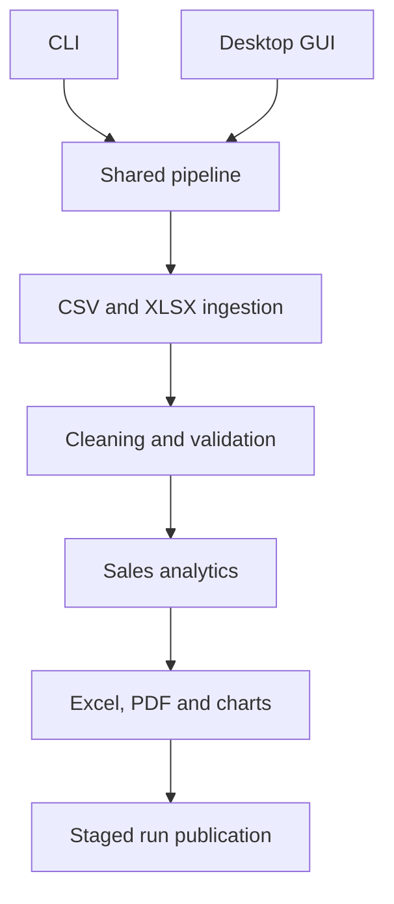

# Architecture and design decisions

`ingestion` normalizes headers and attaches source-file and row provenance.
`processing` owns all checks and calculations. `reporting` receives validated
transactions and precomputed metrics; it never rereads inputs. `pipeline` owns
the application workflow. `cli` and the optional `gui` are input/output adapters.

## Data contract

Required fields: `date`, `product`, `category`, `quantity`, `unit_price`.
Optional: `order_id`. Extra columns are ignored. Orders with multiple product
lines are represented by repeated order IDs. All input files in a run must use
the same order-ID convention.

Prices have at most two decimal places. Quantities are positive whole numbers.
Prices are converted to integer cents before multiplication and aggregation;
display values use decimal currency formats. The single currency label applies
to the whole run. Currency conversion, tax, refunds and exchange rates are not
modeled. Per-line quantities are capped at 1,000,000 and unit prices at
10,000,000,000 currency units. Aggregate integer overflow is rejected.

## Validation policy

| Policy | Behavior | Error report |
| --- | --- | --- |
| `quarantine` | Exclude invalid/duplicate rows | Raw business values, reason and source row |
| `skip` | Exclude invalid/duplicate rows | Reason and source row only |
| `reject_file` | Exclude every row in a file containing any invalid/duplicate row | Invalid-row diagnostics plus rejected file names in manifest |

Schema or ingestion errors stop the whole run because the file cannot be
interpreted reliably. If no usable transactions remain, execution fails before
reports are written and reports the invalid-row/rejected-file counts.

Duplicates are exact normalized business-line matches, using order ID when
available, across all selected files. First occurrence wins. Input order therefore
matters. Identical legitimate lines within the same order cannot be distinguished
without a transaction-line ID; the current schema does not support one. Without
order IDs, identical rows are considered duplicates even if they were separate
purchases. Use separate order IDs to preserve distinct orders. Under `reject_file`,
duplicate detection precedes file rejection, so overlap can reject a later file
even when the earlier file is also rejected for another invalid row.

Calendar months include zero-revenue gaps. Weeks end on Sunday. Month-over-month
change uses the previous calendar month, with an unavailable value for the first
month or a zero prior denominator. Partial boundary months are included and
should be interpreted accordingly. "Top products" in PNG charts ranks units sold;
the products worksheet also exposes revenue.

## Output integrity and safety

Each run creates a private staging directory in the output parent, renders all
requested files, then renames it to a unique `run-<UTC timestamp>-<random id>`
directory. A failed report removes staging and leaves completed prior runs intact.
The manifest records source SHA-256 checksums, accepted/excluded counts, order
semantics and generated files. Input files must remain unchanged while a run is
in progress; checksums are collected at publication time.

Business strings in Excel are explicitly stored as text to prevent spreadsheet
formula interpretation. PDF text is escaped before ReportLab paragraph rendering.
The GUI snapshots widget values on the main thread, processes in a worker, and
returns results through a queue polled by Tk. Chart creation uses the noninteractive
Agg backend. The CLI is intended for one process at a time; concurrent in-process
chart generation is not a supported API contract.

## Scaling limits

Ingestion and validation are vectorized, but input tables are held in memory.
This is a batch tool, not a streaming engine. Excel has a 1,048,576-row worksheet
limit; the transaction export rejects larger datasets. Category charts show up to
20 categories. Memory and rendering cost depend on text length and cardinality.
See the measured single-run example in `benchmark.json`, and reproduce it on the
target machine before setting operational limits.
